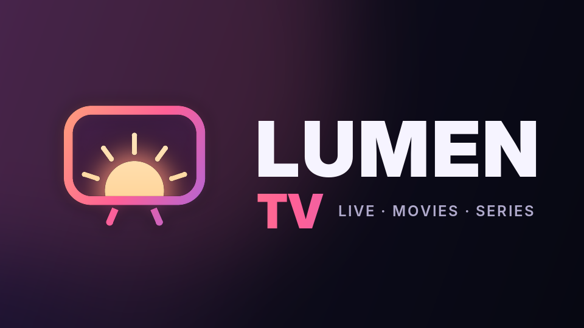

# Lumen TV

A media player for Android TV and Android phones. Bring your own playlist: Lumen TV supports
Xtream-compatible logins (server, username and password) and M3U / M3U8 playlists by link or file.
It doesn't include or provide any channels or content.

One app adapts to the device: a remote-friendly layout with a side menu on TVs, and a touch layout
with a floating tab bar on phones.

## Features

- **Setup that fits you**: pick your country, then the categories you want; your country's are suggested first
- **Live TV** organized by country and genre, with live previews, favorites, recents and channel-number jumping
- **TV guide** grid with catch-up for channels that support it
- **Movies and series** with posters, details, seasons, resume and next-episode autoplay
- **Search** across everything, **continue watching**, and long-press to hide any category
- **Player**: audio and subtitle tracks, quality, aspect, speed, sleep timer, picture-in-picture on phones
- **Parental controls**: adult categories hidden by default, optional PIN
- **Updates**: checks this repository's releases, shows what's new, and installs with your OK

## Install

Download the latest `LumenTV-x.y.z.apk` from [Releases](../../releases) and open it on your device
(you may need to allow installing apps from your browser or file manager). After that, the app
updates itself: **Settings › Updates**.

## Build

See [BUILDING.md](BUILDING.md) for building on a PC (Windows, Linux, macOS) or on an Android phone,
and for publishing updates.

Built with Kotlin, Jetpack Compose, Media3, OkHttp and Coil.
